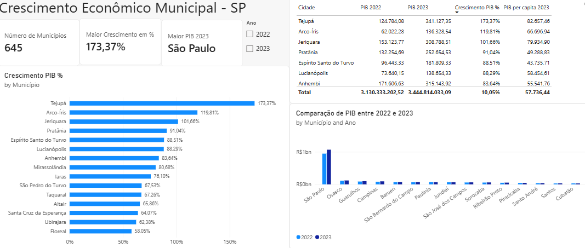

# Dashboard em Power BI

O dashboard apresenta a visualização dos resultados da análise feita sobre o crescimento econômico entre 2022 e 2023.

***

**Visualização:**

**Indicadores:**

- Quantidade total de municípios
- Maiores percentuais de crescimento
- Diferença de percentual de crescimento para todos os municípios
- Comparação entre o PIB dos anos de 2022/2023

***

**Conclusão**

O dashboard complementa a análise trazendo a visualização dos resultados das consultas e comparações.

Para auxiliar na visualização, o escopo dos gráficos foram definidos para mostrar os 15 municípios com maior crescimento em seu PIB.